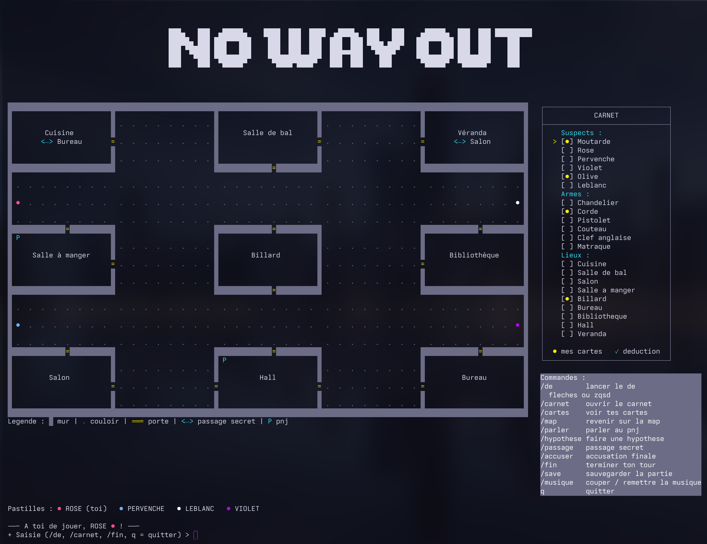

<br/>
<p align="center">
    <picture>
        <source media="(prefers-color-scheme: dark)" srcset="https://github.com/yannouuuu/IUT-SAE1.01/raw/main/.github/assets/header_univlille_light.png" width="200px">
        
    </picture>
</p>

<h1 align="center">No Way Out</h1>

<p align="center">
    <em>Un Cluedo dans ton terminal.</em>
    <br/>
    SAE 3.01 · BUT Informatique · IUT de Lille
</p>

<p align="center">
    
</p>

<p align="center">
    
    
    
</p>

---

## Le jeu

**No Way Out** est un Cluedo jouable entièrement dans le terminal. Le plateau, les cartes, le carnet de déduction et les dés sont dessinés en ASCII/Unicode et colorés en ANSI.

Retrouve **qui** a commis le meurtre, **où** et **avec quelle arme**. Mais toutes les portes du manoir ne s'ouvrent pas : certaines sont verrouillées, et la clé se cache dans une autre pièce. Il faudra écouter les PNJ pour la localiser.

## Fonctionnalités

- **Solo contre 3 bots** ou **multijoueur local** de 2 à 4 joueurs sur le même clavier, avec écran de passation entre les tours.
- **Plateau 5×5** dessiné en ASCII, avec pièces, portes, passages secrets et pastilles colorées pour chaque personnage.
- **Portes verrouillées** : les PNJ donnent une énigme qui indique la salle où se trouve la clé.
- **Déplacement au dé** aux flèches directionnelles (ou `z` `q` `s` `d`), un point de couloir par pas.
- **Carnet de déduction** personnel : on coche suspects, armes et lieux au fil des hypothèses.
- **Hypothèses** auprès des autres joueurs, **accusation finale** et **passages secrets**.
- **Sauvegarde et chargement** de partie dans `sauvegarde/`.
- **Musique de fond** activable/désactivable avec `/musique`.
- Affichage centré et coloré, adapté à un terminal d'environ **160 colonnes**.

## Lancer le jeu

### Prérequis

- **JDK 21** ou supérieur (`java -version`)
- Aucune installation de Maven n'est nécessaire : le wrapper `mvnw` est fourni.

### Installation

```bash
git clone https://github.com/yannouuuu/IUT-SAE3.01-AGILE.git
cd IUT-SAE3.01-AGILE
```

```bash
./run.sh          # Linux / macOS
run.bat           # Windows
```

ou directement :

```bash
./mvnw clean compile exec:java
```

> Pour un affichage confortable, utilise un terminal d'au moins 160 colonnes et une police monospace supportant les caractères Unicode (`█`, `●`, `─`).

## Commandes

| Commande | Effet |
|----------|-------|
| `/de` | Lancer le dé puis se déplacer (flèches ou `z` `q` `s` `d`, `x` pour s'arrêter) |
| `/carnet` | Ouvrir le carnet (Espace pour cocher, `z`/`s` pour naviguer) |
| `/cartes` | Afficher ses cartes de départ |
| `/map` | Revenir sur le plateau |
| `/parler` | Parler au PNJ présent dans la salle |
| `/hypothese` | Proposer suspect + arme + lieu dans la salle courante |
| `/accuser` | Accusation finale : bonne réponse = victoire, mauvaise = défaite |
| `/passage` | Emprunter le passage secret de la salle |
| `/fin` | Terminer son tour |
| `/save` | Sauvegarder la partie |
| `/musique` | Couper ou remettre la musique |
| `/aide` | Rappeler les commandes |
| `q` | Quitter la partie |

Une commande de démonstration, `/cheat_mouvement`, permet de se déplacer sans lancer le dé.

## Règles

1. **Distribution** — les 21 cartes (6 suspects, 6 armes, 9 lieux) sont mélangées. Une carte de chaque catégorie est mise de côté : c'est la solution. Le reste est distribué aux 4 joueurs.
2. **Déplacement** — le dé indique le nombre de points de couloir à parcourir. Entrer dans une salle termine le déplacement.
3. **Portes fermées** — deux pièces sont verrouillées. Le PNJ d'une autre salle donne une énigme dont la réponse est la salle contenant la clé.
4. **Hypothèse** — dans une salle, tu proposes un suspect, une arme et le lieu courant. Le premier joueur qui possède une de ces cartes te la montre ; elle est cochée dans ton carnet.
5. **Accusation** — tu peux accuser à tout moment. Une erreur met fin à la partie.
6. **Passages secrets** — Cuisine ↔ Bureau et Véranda ↔ Salon permettent de traverser le manoir.

## Architecture

```
src/main/java/
├── Main.java                    Point d'entrée
├── moteur/
│   ├── BoucleDeJeu.java         Machine à états Menu → Partie → Fin
│   ├── EtatPartie.java          Joueurs, solution, portes et PNJ
│   ├── InitialiserPartie.java   Distribution des cartes et création des joueurs
│   └── TourManager.java         Ordre des tours
├── modele/                      Joueur, Bot, cartes, enums suspects/armes/lieux
├── deplacement/                 Dé, déplacement case par case
├── carnet/                      Carnet de déduction
├── interaction/                 Saisie, parsing des commandes, PNJ
├── enigmes/                     Énigmes et portes verrouillées
├── ui/                          Plateau, carnet, cartes, dés, cadres, menu
├── son/                         Musique de fond
└── historique/                  Sauvegarde et chargement
```

## Tests

```bash
./mvnw test
```

Les tests couvrent le carnet, le parsing des commandes, les portes verrouillées, la distribution des cartes, les énigmes, l'état de partie et l'ordre des tours.

## Équipe

Projet réalisé en équipe dans le cadre de la SAE 3.01 du BUT Informatique à l'IUT de Lille :

- Yann RENARD
- Paloma Fiquet
- Chloé Tison — illustrations ASCII des cartes
- Virgile Lefévre
- Charly Coic
- Timéo
- Shafi

## Remerciements

Merci aux enseignants de l'IUT de Lille pour les cours, TP et SAE qui ont rendu ce projet possible.

<br/>
<p align="center">
    <picture>
        
    </picture>
</p>
