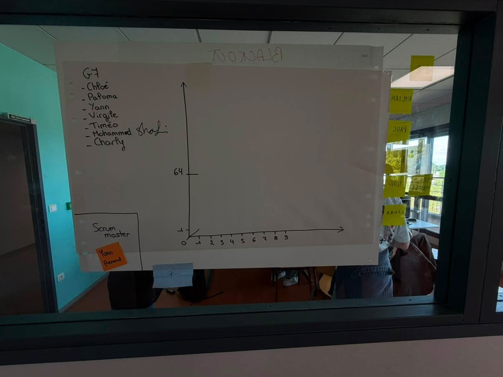

# Sprint 1

Scrum Master : Yann RENARD

## Démo + Planification du sprint suivant

### Ce que nous avons fait durant ce sprint
Nous avons rendu le prototype de la map du cluedo.

### Ce que nous allons faire durant le prochain sprint
Faire un contrôle de saisie.

## Rétrospective

### Sur quoi avons nous butté ?
Un grand retard a été pris alors peu de choses ont été faite.
* Qu'est ce qu'il s'est parfaitement bien passé pendant le sprint (démo, rétro, organisation, répartition des US, répartition des taches, prédictibilité, technique, git, java, ide, etc.)
Nous avons un bon début avec une belle map, une bonne compréhension du code.
* Qu’est-ce qui m'a irrité ? dérangé ?
La perte de temps dans le projet. Ça a été compliqué de se mettre en accord sur un jeu ou bien même les étapes que nous voulons faire au sein du projet.

### PDCA
* Quel sujet souhaitons nous améliorer ? (1 seul)
La coopération au sein du groupe
* Comment améliorer (3 options recommandés)
Prendre en compte l'avis de tout le monde, tenir au courant des changements et communiquer.
* Quelle action mettons nous en place sur le prochain sprint ?
Se mettre en accord au début du sprint pour être sûr qu'il n'y ai aucune ambiguïté.

# Mémo
N’oubliez pas d’ajouter une photo du radiateur d’information (kanban + BurnUp) au moment de la rétrospective.

## Radiateur d'information

