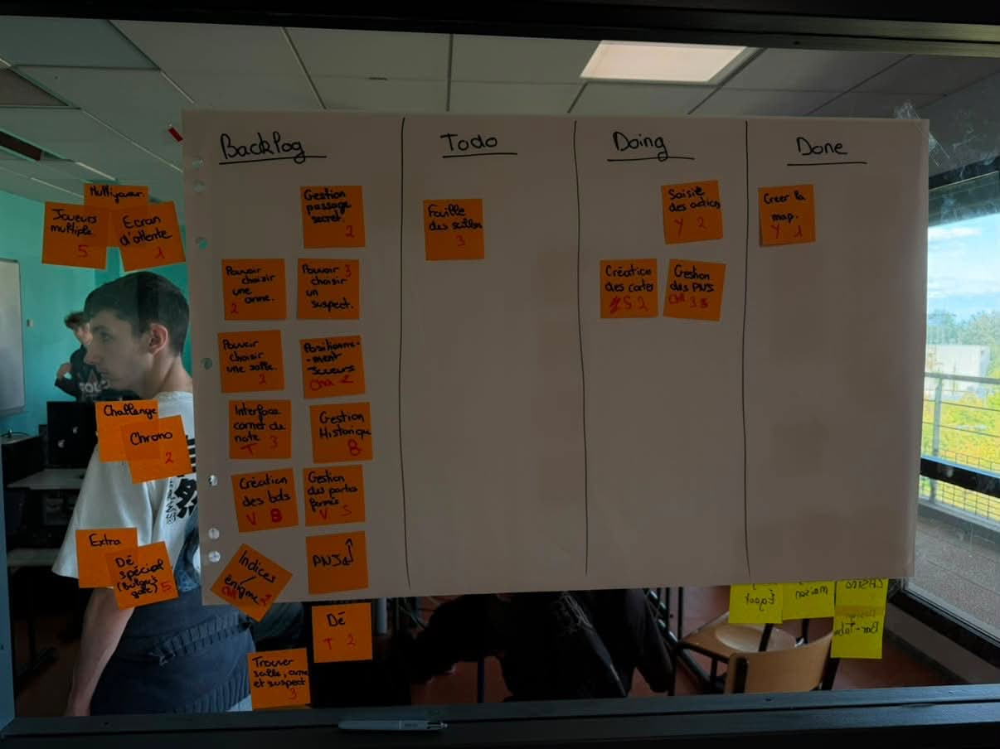

# Sprint 1

Scrum Master : Yann RENARD

## Démo + Planification du sprint suivant

### Ce que nous avons fait durant ce sprint
Nous avons rendu le prototype de la map du cluedo.

### Ce que nous allons faire durant le prochain sprint
Donnez ici la liste des histoires utilisateurs que vous vous engagez à terminer durant le prochain sprint.

## Rétrospective

### Sur quoi avons nous butté ?
Lister ici tout ce qui s'est parfaitement bien passé et ce qui n'a pas été parfait.
* Qu'est ce qu'il s'est parfaitement bien passé pendant le sprint (démo, rétro, organisation, répartition des US, répartition des taches, prédictibilité, technique, git, java, ide, etc.)
* Qu’est-ce qui m'a irrité ? dérangé ?

### PDCA
* Quel sujet souhaitons nous améliorer ? (1 seul)
* Comment améliorer (3 options recommandés)
* Quelle action mettons nous en place sur le prochain sprint ?

# Mémo
N’oubliez pas d’ajouter une photo du radiateur d’information (kanban + BurnUp) au moment de la rétrospective.

## Radiateur d'information

![Radiateur d'information(radiateur02.png)