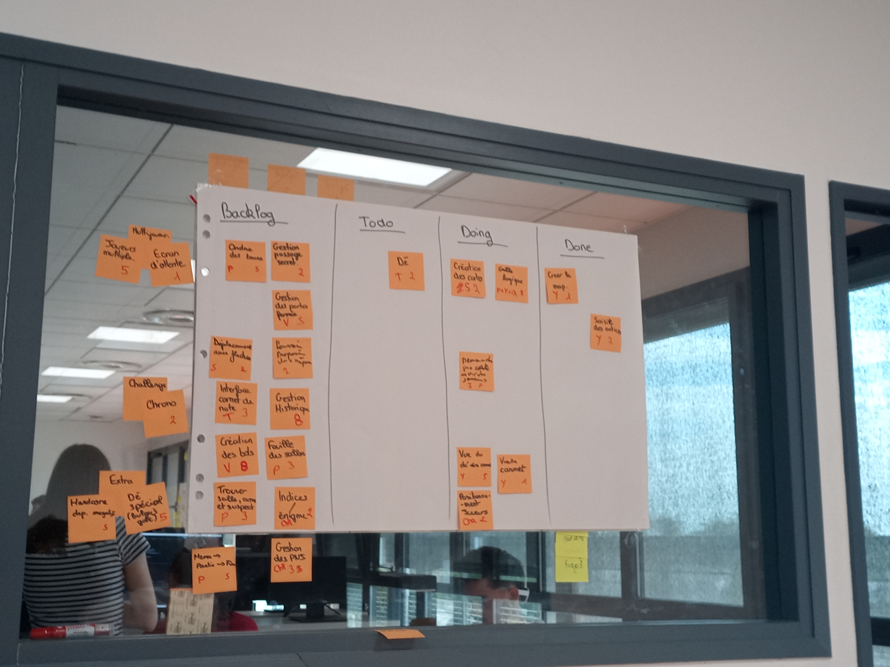
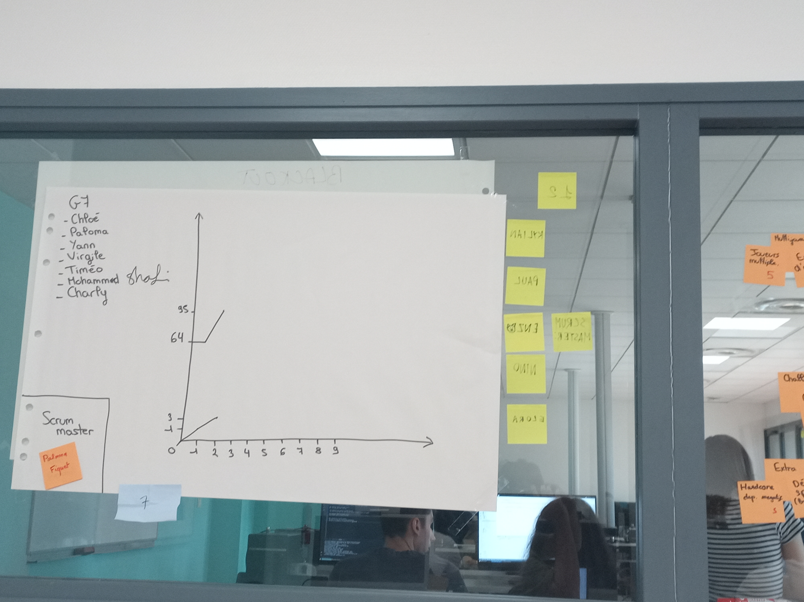

# Sprint 2

Scrum Master : Paloma Fiquet

## Démo + Planification du sprint suivant

### Ce que nous avons fait durant ce sprint
Nous avons rendu la saisie des actions.

### Ce que nous allons faire durant le prochain sprint
La création des cartes, incluant le faît de demander à un joueur une carte, le positionnement du joueur, le dé et la vue du dé, la vue du carnet.

## Rétrospective

### Sur quoi avons nous butté ?
Bien que la saisie des actions ait été faîte, la plupart du reste sont des bouts de codes non reliée entre eux. Donc au final on avait plein de classes et fonctions qui n'intérragisent pas entre-eux. 
* Qu'est ce qu'il s'est parfaitement bien passé pendant le sprint (démo, rétro, organisation, répartition des US, répartition des taches, prédictibilité, technique, git, java, ide, etc.)
Le GUI de base s'affiche bien et on peut quitter le jeu correctement.
* Qu’est-ce qui m'a irrité ? dérangé ?
Au final on avait pas grand chose à montrer malgrès tout ce qu'on à coder.

### PDCA
* Quel sujet souhaitons nous améliorer ? (1 seul)
L'intéractivité.
* Comment améliorer (3 options recommandés)
Faire le positionnement et les actions reliée à d'autre UE.
* Quelle action mettons nous en place sur le prochain sprint ?
Les actions utilisateur.

# Mémo
N’oubliez pas d’ajouter une photo du radiateur d’information (kanban + BurnUp) au moment de la rétrospective.

## Radiateur d'information

