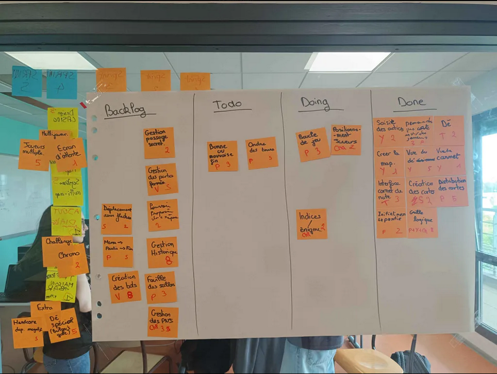
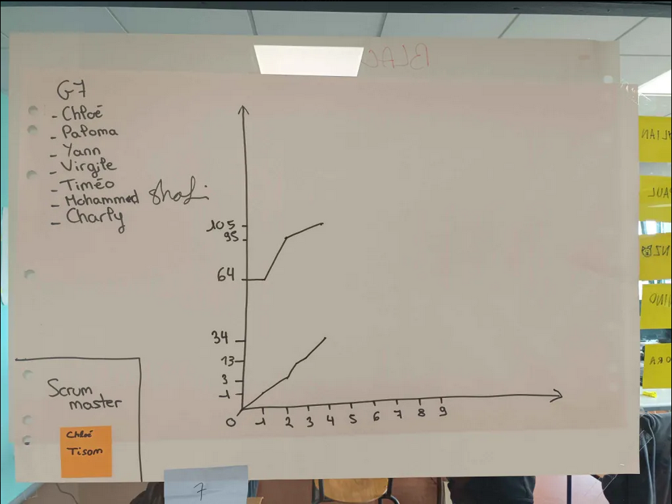

# Sprint 4

Scrum Master : Chloé Tison

## Démo + Planification du sprint suivant

### Ce que nous avons fait durant ce sprint
Nous avons rendu le dé ainsi que la vu du dé, la vue sur le carnet, la création des cartes incluant la distribution des cartes ainsi que la demande d'une carte à un joueur.

### Ce que nous allons faire durant le prochain sprint
Pouvoir initialiser une partie et faire la grille logique.

## Rétrospective

### Sur quoi avons nous butté ?
On commence petit à petit à tout rassembler, incluant les cartes dans le jeu, un carnet de saisie et pouvoir intéragir avec les autres joueurs.
* Qu'est ce qu'il s'est parfaitement bien passé pendant le sprint (démo, rétro, organisation, répartition des US, répartition des taches, prédictibilité, technique, git, java, ide, etc.)
Le carnet fonctionne parfaitement bien et s'affiche bien à l'endroit voulu. Pour le dé l'affichage est super. Tout le monde a bien travailler entre eux, une bonne avancée a été faite.
* Qu’est-ce qui m'a irrité ? dérangé ?
Problème dans le git.

### PDCA
* Quel sujet souhaitons nous améliorer ? (1 seul)
Gérer l'ascii moche.
* Comment améliorer (3 options recommandés)
Rechercher un meilleur ascii, essayer une autre police d'écriture.
* Quelle action mettons nous en place sur le prochain sprint ?
Résoudre le probème git.

# Mémo
N’oubliez pas d’ajouter une photo du radiateur d’information (kanban + BurnUp) au moment de la rétrospective.

## Radiateur d'information

