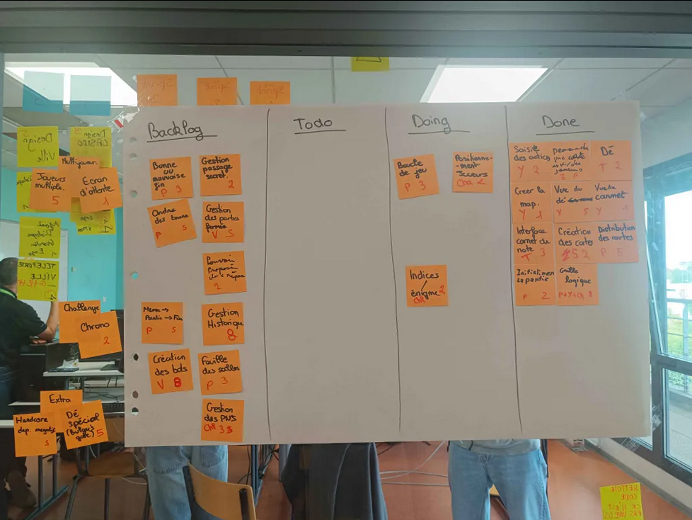
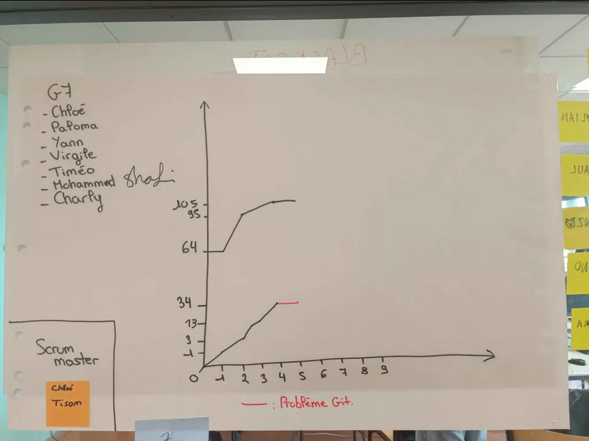

# Sprint 5

Scrum Master : Chloé Tison

## Démo + Planification du sprint suivant

### Ce que nous avons fait durant ce sprint
Nous avons rendu la grille logique ainsi que l'initialisation de la partie. (en back, pas en front)

### Ce que nous allons faire durant le prochain sprint
Faire la bonne ou mauvaise fin, faire l'ordre des tours, le positionnement des joueurs. Et grille logique et l'initialisation de la partie en visuel.

## Rétrospective

### Sur quoi avons nous butté ?
Un petit souci de git nous a ralenti mais nous gardons un bon rythme et une bonne communication.
* Qu'est ce qu'il s'est parfaitement bien passé pendant le sprint (démo, rétro, organisation, répartition des US, répartition des taches, prédictibilité, technique, git, java, ide, etc.)
Un bon travail d'équipe, nous nous aidons entre-nous lorsque nous avons dû mal avec certaines US.
* Qu’est-ce qui m'a irrité ? dérangé ?
Git.

### PDCA
* Quel sujet souhaitons nous améliorer ? (1 seul)
Moins de problèmes git.
* Comment améliorer (3 options recommandés)
Faire plus attention, communiquer entre nous pour éviter les conflits.
* Quelle action mettons nous en place sur le prochain sprint ?
Faire le visuel pour ce qui a été fait en back.

# Mémo
N’oubliez pas d’ajouter une photo du radiateur d’information (kanban + BurnUp) au moment de la rétrospective.

## Radiateur d'information

