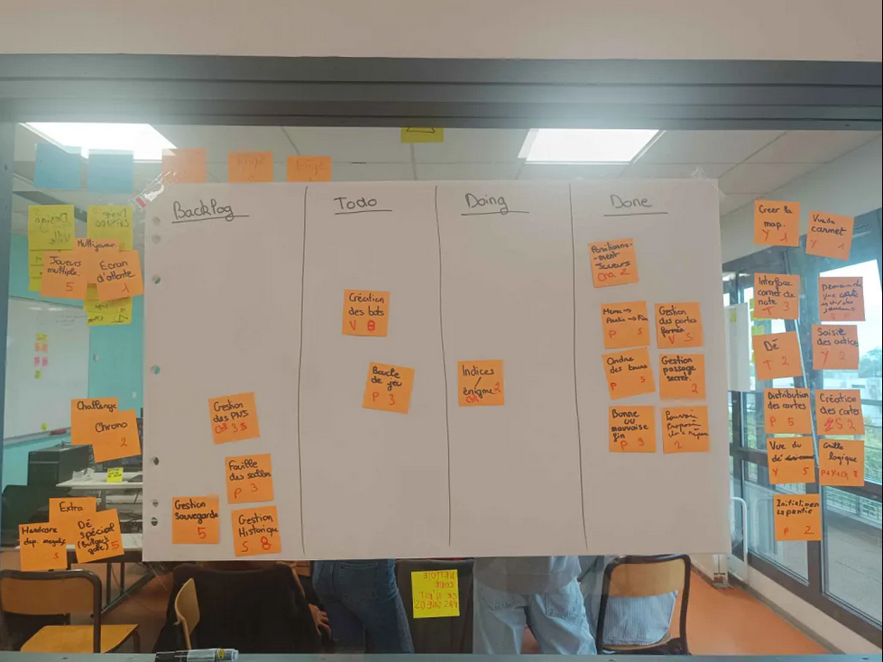
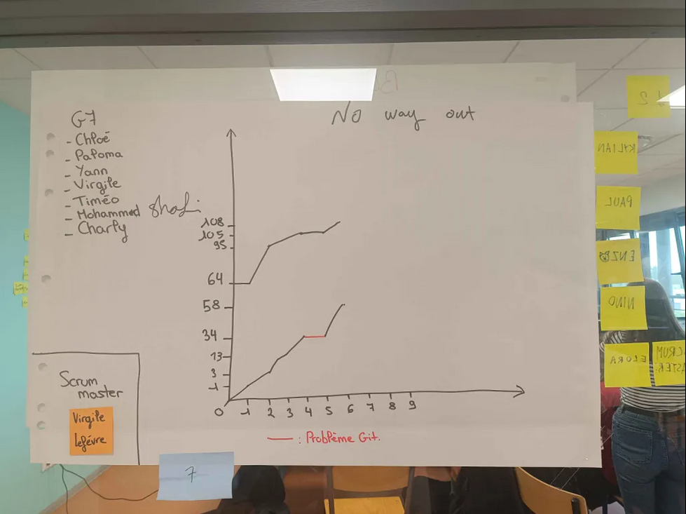

# Sprint 6

Scrum Master : Virgile Lefévre

## Démo + Planification du sprint suivant

### Ce que nous avons fait durant ce sprint
La grille logistique et l'initialisation de la partie en visuel. Ainsi que le positionnement des joueurs, faire un menu qui peut mener à une partie puis une fin, la gestion des portes fermées, l'ordre des tours, la gestion des passages secrets, la fin du jeu, et pour terminer pouvoir proposer une réponse.

### Ce que nous allons faire durant le prochain sprint
La création des bots, la boucle de jeu, indice et enigmes intégrés et gestions des PNJ.

## Rétrospective

### Sur quoi avons nous butté ?
Tout ce qui n'était pas relié se reli et nous apporte plusieurs US de fini.
* Qu'est ce qu'il s'est parfaitement bien passé pendant le sprint (démo, rétro, organisation, répartition des US, répartition des taches, prédictibilité, technique, git, java, ide, etc.)
Un bon partage des tâches ce qui nous a permis d'avancer d'avantage.
* Qu’est-ce qui m'a irrité ? dérangé ?
Se mettre d'accord sur les règles du jeu.

### PDCA
* Quel sujet souhaitons nous améliorer ? (1 seul)
Dans le positionnement des joueurs, les noms que nous avons donné au pions.
* Comment améliorer (3 options recommandés)
Modifier les noms, les mettres en fonction de ce que le ou les joueurs se donnent comme pseudo/prénom.
* Quelle action mettons nous en place sur le prochain sprint ?
Continuer à tout relier.

# Mémo
N’oubliez pas d’ajouter une photo du radiateur d’information (kanban + BurnUp) au moment de la rétrospective.

## Radiateur d'information

