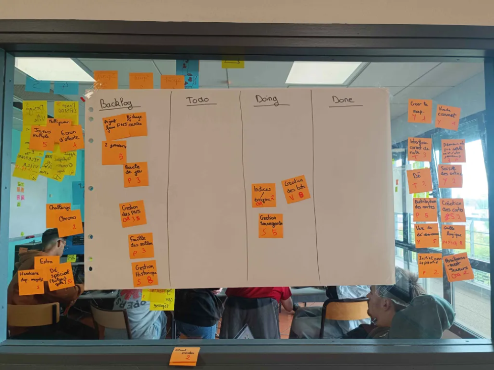
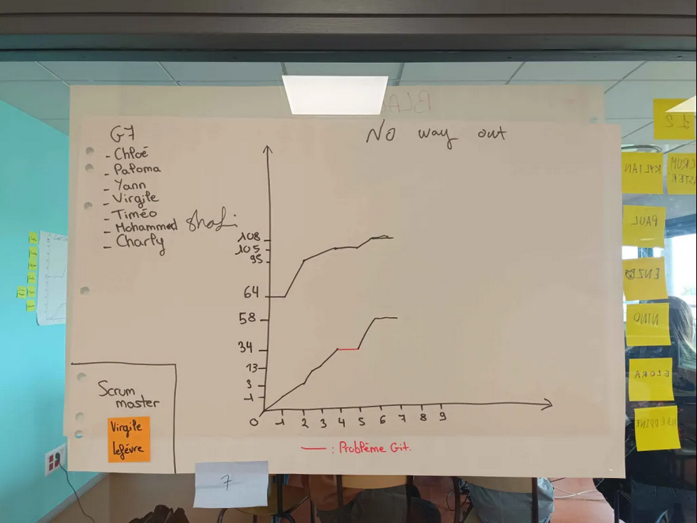

# Sprint 7

Scrum Master : Virgile Lefévre

## Démo + Planification du sprint suivant

### Ce que nous avons fait durant ce sprint
Créations de cheat code pour la démo.

### Ce que nous allons faire durant le prochain sprint
Corrigé les différents bugs.

## Rétrospective

### Sur quoi avons nous butté ?
Réflechir à comment corrigés les bugs que nous avons rencontré.
* Qu'est ce qu'il s'est parfaitement bien passé pendant le sprint (démo, rétro, organisation, répartition des US, répartition des taches, prédictibilité, technique, git, java, ide, etc.)
Avancement sur les US de révisions.
* Qu’est-ce qui m'a irrité ? dérangé ?
Les bugs.

### PDCA
* Quel sujet souhaitons nous améliorer ? (1 seul)
Les portes, le fait qu'on peut tomber sur les cartes qu'on détient, et le carnet.
* Comment améliorer (3 options recommandés)
Aller chercher le problème dans le code, réfléchir à comment le réparer ou changer de méthode.
* Quelle action mettons nous en place sur le prochain sprint ?
Faire en sorte que ces bugs n'existes plus.

# Mémo
N’oubliez pas d’ajouter une photo du radiateur d’information (kanban + BurnUp) au moment de la rétrospective.

## Radiateur d'information

