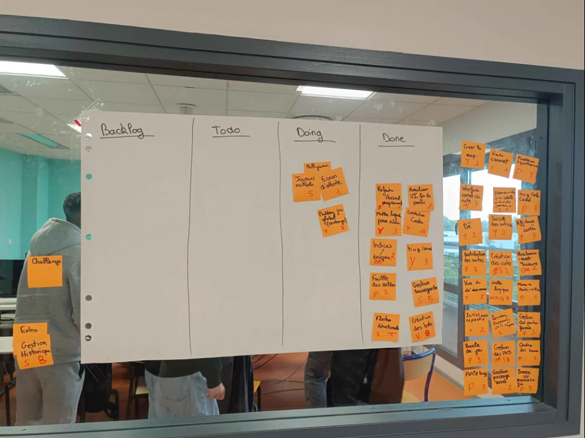
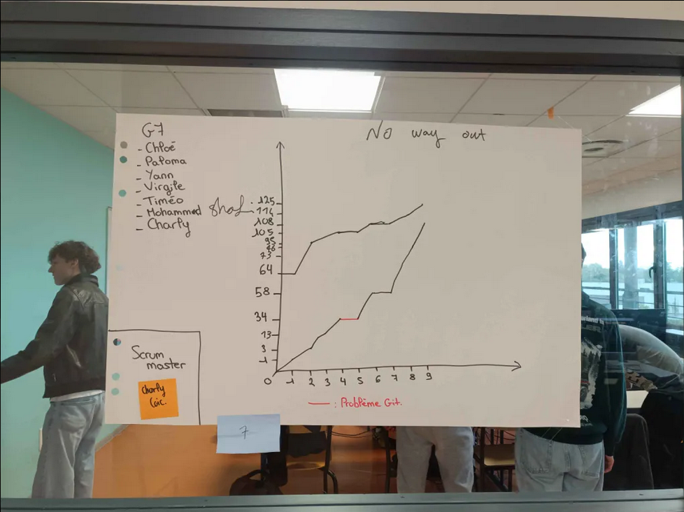

# Sprint 9

Scrum Master : Charly Coic

## Démo + Planification du sprint suivant

### Ce que nous avons fait durant ce sprint
Ajouter une légende, mettre de la colorie sur les cartes, les indices/énigmes, le bug du carnet ainsi que la fouille des salles.

### Ce que nous allons faire durant le prochain sprint
Il n'y a pas de prochain sprint.

## Rétrospective

### Sur quoi avons nous butté ?
La correction des bugs s'est faite tranquillement, nous pouvons maintenant avancer sur la suite et améliorer certaines choses.
* Qu'est ce qu'il s'est parfaitement bien passé pendant le sprint (démo, rétro, organisation, répartition des US, répartition des taches, prédictibilité, technique, git, java, ide, etc.)
Ce que nous voulions faire a été fait donc grande satisfaction, une bonne organisation.
* Qu’est-ce qui m'a irrité ? dérangé ?
Nous avons beaucoup trop d'US ce qui fait que nous avons perdu beaucoup de temps et maintenant nous devons tout faire sur le dernier sprint.

### PDCA
* Quel sujet souhaitons nous améliorer ? (1 seul)
L'affiche du menu et de la fin ainsi que l'affichage des cartes.
* Comment améliorer (3 options recommandés)
Faire des recherches pour trouver mieux, modifier ou demander conseil à notre équipe, ajouter des couleurs.
* Quelle action mettons nous en place sur le prochain sprint ?
Tout finir.

# Mémo
N’oubliez pas d’ajouter une photo du radiateur d’information (kanban + BurnUp) au moment de la rétrospective.

## Radiateur d'information

